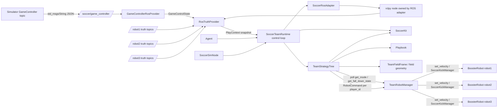
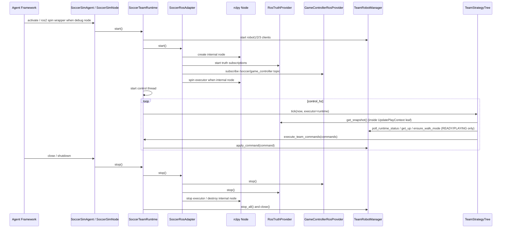
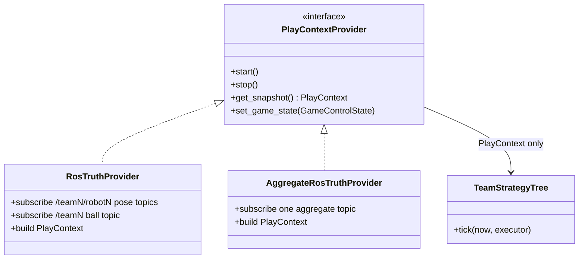
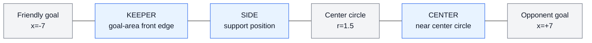
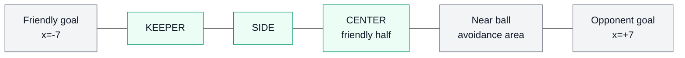
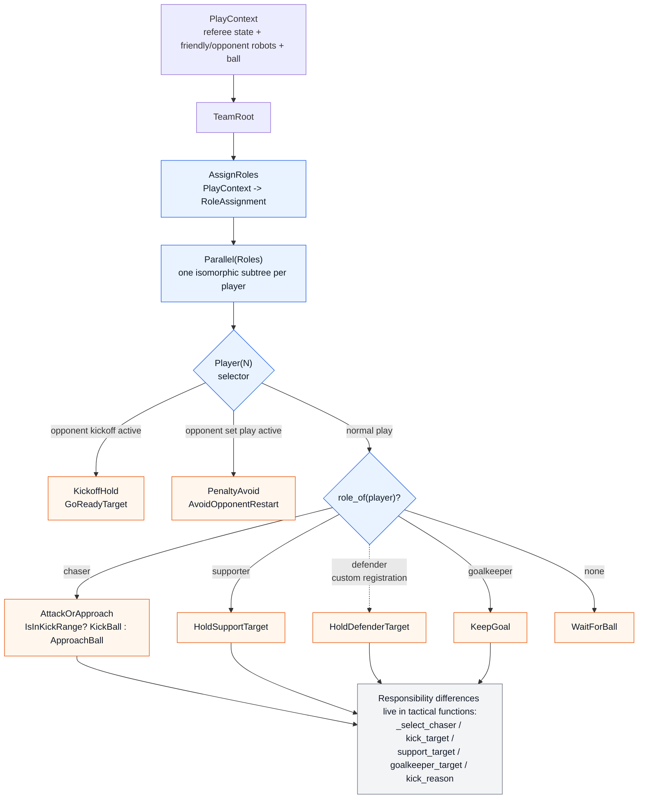

# SoccerSim 3v3 Agent Implementation Notes

This document describes the current implementation and is intended for quickly understanding the overall structure before code review and simulation-environment testing. Runtime configuration, launch commands, Docker debugging, and simulation testing suggestions are covered in [operations.md](operations.md); the `src/` code map is in [src/README.md](../src/README.md).

## 1. Overall Architecture

The current implementation separates the "framework entry point", "runtime adaptation", "referee-state interpretation", and "pure strategy logic":

- `src/soccer_framework/`: soccer-environment framework package. Developers should primarily import data and command interfaces such as `PlayContext`, `RobotCommand`, `MoveIntent`, `KickIntent`, and `SoccerConfig` from here; ROS topics, the GameController provider, and boosteros robot objects are wrapped inside adapters.
- `src/main.py`: Booster Agent entry point. The Agent only keeps lifecycle entry points and forwards startup / shutdown to the shared runtime. This file keeps the full entry implementation so launch semantics are not hidden inside the framework package.
- `src/runtime.py`: project assembly layer, including `SoccerKit` and `SoccerTeamRuntime`. It wires framework adapters and `TeamStrategyTree` together and runs the control loop. ROS node, subscriptions, and executor lifecycle are pushed down into `SoccerRosAdapter`. The framework does not import this layer in reverse.
- `src/soccer_framework/types.py`: pure data types plus the `PlayContextProvider` abstraction.
- `src/soccer_framework/config.py`: `SoccerConfig` / `SoccerStrategyTuning` / `SoccerDebugConfig` and the `from_env` entry point.
- `src/soccer_framework/game_state.py`: GameController JSON encoding and decoding.
- `src/soccer_framework/ros_truth.py`: `RosTruthProvider`, the environment-observation adapter.
- `src/soccer_framework/robot.py`: `TeamRobotManager` plus `PlayerKickStateMachine`, the robot-control adapter.
- `src/soccer_framework/game_controller.py`: `GameControllerRosProvider`, the GameController topic provider.
- `src/soccer_framework/ros_adapter.py`: `SoccerRosAdapter`, which owns the ROS node, truth provider, GameController provider, and internal executor startup / shutdown.
- `src/soccer_framework/telemetry.py`: `SoccerLogger` wrapper and JSONL structured-log plugin; business code uses the logger interface uniformly.
- `src/tactics/`: pure model objects. `geometry.py` (coordinate transforms / team-view field geometry / legal target clamp), `targeting/` (shoot / pass / support / restart / recovery submodules), `navigation.py` (obstacle avoidance and path calculation), `motion.py` (walk / obstacle avoidance / kick commands), `kick_hysteresis.py` (kick enter / exit hysteresis), and `ready_stance.py` (READY stance).
- `src/behavior_tree/`: BT infrastructure. `tree.py` (`TeamStrategyTree` top-level assembly plus `create_team_tree` factory), `blackboard.py` (centralized blackboard-key table plus `BlackboardClient`), `ready_subtree.py` / `safety_subtree.py` (subtree factories), and `nodes/` (data / condition / action leaf nodes).
- `src/play/`: PLAY-stage strategy, the core example. `playbook.py` (`Playbook` + `DefaultPlaybook` + chaser scoring), `role.py` + `default_roles.py` (role base class + default dynamic responsibilities), `registry.py` (`PLAYBOOKS` registry), `play_subtree.py` (PLAY subtree), and `nodes.py` (role conditions + action leaves).
- `TeamStrategyTree` in `src/behavior_tree/tree.py` is the template top-level facade: it assembles `SoccerKit` + `Playbook` + the behavior-tree root, takes `PlayContext` as input, drives the behavior tree through `tick()`, and emits / executes one `RobotCommand` per robot.
- `ros_debug/soccer_sim_debug/`: independent ROS2 debug package. `soccer_sim_debug/ros_node.py` behaves as a replacement for `SoccerSimAgent` and can be launched with `ros2 run`; the repository root is no longer exposed as a ROS package.
- `tests/test_soccer_framework_core.py`: covers pure strategy and rule logic without depending on ROS, boosteros, or the simulation environment.



The core boundary is `PlayContextProvider`. The strategy layer and robot-control layer do not build topic names and do not care about `/teamN/...` topic prefixes; those details exist only inside `RosTruthProvider`.

## 2. Class Responsibilities

### `src/main.py`

| Class | Responsibility |
| --- | --- |
| `SoccerSimAgent` | Booster Agent entry point. It does not subscribe to ROS2 messages directly and does not own an `rclpy` node; it creates `SoccerTeamRuntime`, starts the runtime on activation, and stops the runtime plus structured logging on shutdown. |

### `ros_debug/soccer_sim_debug/soccer_sim_debug/ros_node.py`

| Class | Responsibility |
| --- | --- |
| `SoccerSimNode` | Entry point for the standalone ROS2 debug package. It creates `SoccerConfig` from ROS parameters and starts the same `SoccerTeamRuntime`. This package is only used for command-line debugging and is not part of Booster Agent packaging. |

### `src/runtime.py`

| Class | Responsibility |
| --- | --- |
| `SoccerKit` | Team toolset. Holds all tools unrelated to a specific play style: field coordinates, rule checks, obstacle avoidance, kick hysteresis, READY stance, and move / kick command output helpers. BT leaf nodes and `Playbook` access these via properties such as `kit.targeting` / `kit.motion`. |
| `SoccerTeamRuntime` | Project assembly layer. Creates `SoccerKit`, `Playbook`, robot manager, `SoccerRosAdapter`, and `TeamStrategyTree`; creates `SoccerRosAdapter` after `TeamRobotManager` initialization; starts the control loop; on shutdown, stops the thread, ROS adapter layer, and robots. |

### `src/soccer_framework/ros_adapter.py`

| Class | Responsibility |
| --- | --- |
| `SoccerRosAdapter` | ROS integration adapter layer. In the normal runtime path, creates an internal `sim_bridge` node, truth provider, GameController provider, and background `SingleThreadedExecutor`; when a lower-level external node is passed in, it only creates subscriptions and does not take over spin / destroy. |

### `src/soccer_framework/ros_truth.py`

| Class | Responsibility |
| --- | --- |
| `RosTruthProvider` | v1 simulation ground-truth adapter. Subscribes to friendly robot poses, opponent robot poses, and the team-level `/teamN/.../ball` under the same `/teamN` viewpoint, receives robot states polled by runtime, and aggregates them into a unified `PlayContext`. |

### `src/soccer_framework/game_controller.py`

| Class | Responsibility |
| --- | --- |
| `GameControllerRosProvider` | Referee-state provider. Every Agent subscribes to a ROS2 topic to obtain referee state and only consumes the simulator-published `/soccer/game_controller` topic; its structure is consistent with `RosTruthProvider` and is started / stopped uniformly by `SoccerRosAdapter`. |

### `src/soccer_framework/robot.py`

| Class | Responsibility |
| --- | --- |
| `TeamRobotManager` | Manages `BoosterRobot` and the corresponding `SoccerKickManager`. It exposes only runtime-status polling, get-up / mode recovery, and final command execution to the strategy layer: `set_velocity`, `SoccerKickManager.start/update/stop`; soccer / walk mode is restored only when walking commands are needed in READY / PLAYING. |
| `PlayerKickStateMachine` | Encapsulates one player's kicking channel and handles `SoccerKickManager.start/update/stop`, minimum active time, and chassis-channel release. |

### `src/soccer_framework/types.py`

| Type / Class | Responsibility |
| --- | --- |
| `PlayContextProvider` | Data-source abstraction interface: `start()`, `stop()`, `get_snapshot()`, and `set_game_state()`. Future simulation truth formats only need a different provider. |
| `PlayContext` | The only strategy input. It contains referee state, friendly teammates, opponent robots, ball state, and update time. Freshness filtering is done uniformly in the behavior-tree data layer: expired `game_state` / `ball` / `pose` values are set to `None`, so the strategy layer reads an already-filtered snapshot. Robot hardware mode / fall-down state is polled by the behavior-tree data layer through `TeamRobotManager` and stored under separate blackboard keys. |
| `RobotRuntimeStatus` | Polled from the robot API by runtime. Contains current mode, fall-down state, recoverability, and update time. |
| `GameControlState` | Structured representation of referee state, including main state, set play, teams, and player penalties. `last_seen_at` records the last received topic time and is used by the data layer for freshness filtering. |
| `RobotCommand` | Robot action command. `MoveIntent` represents chassis velocity, `KickIntent` represents kick direction / power and ball position in the robot coordinate frame, `StopIntent` represents stop, and `reason` is used for debugging. |

### `src/soccer_framework/config.py`

| Type / Class | Responsibility |
| --- | --- |
| `SoccerConfig` | Centralized configuration for team, robot names, opponent robot names, roles, control rate, field size, strategy tuning, and debug switches. |
| `SoccerStrategyTuning` | Strategy parameter collection. Includes pass scoring thresholds, obstacle radius, advance distance, support distance, and more; it is adjusted through dataclass defaults, constructor arguments, or ROS debug parameters, not environment variables. |
| `SoccerDebugConfig` | Debug parameter collection. Currently includes behavior-tree tick trace switch and sample interval; adjusted through `SoccerConfig(debug=...)` or ROS debug parameters. |

### `src/soccer_framework/game_state.py`

| Function | Responsibility |
| --- | --- |
| `game_control_state_from_json` | Parses the JSON payload of the `/soccer/game_controller` topic and produces `GameControlState`. |
| `game_control_state_to_json` | Serializes `GameControlState` back to JSON for testing and replay. |

### `src/tactics/geometry.py`

| Type / Class | Responsibility |
| --- | --- |
| `TeamFieldFrame` | Computes the friendly goal, opponent goal, and friendly-half constraints using the `/teamN` ground-truth team field coordinate system; also provides in-field target clamping and restart avoidance target calculation. Avoidance radius is read uniformly from `SoccerConfig.strategy.opponent_restart_avoid_distance_m`. The strategy layer always uses `+x` for attack and `-x` for defense. |

### `src/behavior_tree/tree.py`

| Type / Class | Responsibility |
| --- | --- |
| `TeamStrategyTree` | Template top-level facade. Each frame calls `tick(now=None, executor=None)`, which refreshes the behavior-tree blackboard and submits `RobotCommand`. When `now=None`, it defaults to `time.monotonic()`. |
| `create_team_tree` | Factory that constructs the full team behavior-tree root plus commit node; called internally by `TeamStrategyTree` and also usable directly in unit tests that assemble bare trees. |
| `RobotServices` | Protocol through which the behavior tree accesses hardware services. Currently implemented by `TeamRobotManager`. |

## 3. Runtime Lifecycle



The lifecycle is idempotent: repeated activation does not duplicate subscriptions or create duplicate robots; shutdown first stops the control thread, then stops the ROS adapter layer and robots.

## 4. Runtime Configuration

Runtime configuration, including environment variables, ROS parameters, Docker debug scripts, and launch commands, is covered in [operations.md](operations.md). The rest of this document assumes contestants can already run the Agent.

## 5. Data Flow and Extension Points

### Current Provider

The current `RosTruthProvider` subscribes to topics with team prefixes. For `team_id=1`, `robot_names=robot1,robot2,robot3`, and `opponent_robot_names=robot4,robot5,robot6`, the topics are:

- `/team1/robot1/soccer/sim/ground_truth/robot_pose`
- `/team1/robot2/soccer/sim/ground_truth/robot_pose`
- `/team1/robot3/soccer/sim/ground_truth/robot_pose`
- `/team1/robot4/soccer/sim/ground_truth/robot_pose`
- `/team1/robot5/soccer/sim/ground_truth/robot_pose`
- `/team1/robot6/soccer/sim/ground_truth/robot_pose`
- `/team1/soccer/sim/ground_truth/ball`

Pose and ball messages are read as `geometry_msgs/Pose2D`. `robot_pose` has one topic per robot; `ball` is a team-level topic shared within the team. Robot poses and ball coordinates in `/teamN/...` topics are already expressed relative to the team field coordinate system: for every team, the friendly goal is fixed at `x=-7.0`, the opponent goal is fixed at `x=+7.0`, `+x` is the team's attacking direction, and `-x` is the team's defending direction. Simulation matches can use these subscribed ground-truth values directly; strategy code or runtime code does not need extra coordinate conversion.

The team field coordinate system differs from the absolute field coordinate system. Absolute field coordinates make both teams share one fixed field direction, so team1 / team2 may need mirroring based on side or half. Team field coordinates already fold away that difference. A provider must read friendly and opponent robots under the same `/teamN` topic prefix and must not switch to `/team{opponent}`; the strategy layer does not flip field direction based on `team_id`, half, or topic prefix. If a future input source changes to absolute field coordinates, mirroring / rotation should be done in the `PlayContextProvider` adapter layer, and data entering `PlayContext` should still follow the team field coordinate convention.

When strategies move toward the ball, they use team field coordinates. After entering `SoccerKickManager`, `PlayContext.ball` is transformed back into the robot coordinate frame according to the current robot pose and passed to `update_ball()`.

In other words, the current unified interface is:

```text
sim ground truth field ball
  -> PlayContext.ball
  -> strategy uses field ball for approach
  -> strategy converts field ball to robot-relative ball for SoccerKickManager.update_ball
```

### Future Single-Topic Ground Truth



If simulation ground truth later changes to "one topic publishes all robot and ball positions", only `AggregateRosTruthProvider` needs to be added. It only has to output the same `PlayContext`; strategy implementations and `TeamRobotManager` do not need changes.

## 6. GameController Integration

Referee state now enters the strategy layer uniformly through a ROS2 topic. The runtime component is `GameControllerRosProvider`, assembled by `SoccerRosAdapter` together with `RosTruthProvider`:

- Every Agent subscribes to the configured `game_controller_topic`, defaulting to `/soccer/game_controller`.
- The simulation environment automatically publishes referee state to `/soccer/game_controller`; the Agent only consumes this ROS2 topic.

The topic callback deserializes the payload through `game_control_state_from_json()` and writes it into the provider. Freshness checks are performed uniformly by the watchdog inside the behavior-tree data layer: if referee state, ball, or robot pose has not been refreshed for too long, `DataLayer` sets the corresponding field to `None`. After that, `SafetyGuards` handles invalid inputs at the entry point. For example, missing referee state triggers `StopAll("no game controller state")`, and a missing ball in `PLAYING` triggers `StopAll("waiting for ball")`.

The recommended simulation configuration is to keep the default; this topic is not injected through runtime environment variables.

## 7. Strategy and Rule-Layer Flow

The strategy entry point is `TeamStrategyTree.tick(now=None, executor=None)`. Each frame writes `PlayContext` to the behavior-tree blackboard, the behavior tree generates a `dict[player_id, RobotCommand]`, and finally runtime executes or records commands through `execute_team_commands()`.

Every control tick enters the same team-level `py_trees` behavior tree. The top level is a `Sequence`: first write external inputs to the blackboard, then select the current match phase, then repair this frame's `/cmd/{player_id}` through per-player `SafetyOverrides`, and finally hand commands to the executor uniformly.

```text
Sequence(TeamRoot, memory=False)
  +- Sequence(DataLayer)
  |    +- UpdateClock
  |    +- UpdatePlayContext           # write directly from PlayContextProvider snapshot to blackboard
  |    +- UpdateGameState             # set to None when watchdog expires
  |    +- UpdateRecentBall            # set to None when watchdog expires
  |    +- UpdateRobotPoses            # set pose to None when watchdog expires
  |    +- UpdateRobotStatus(N)        # write RobotRuntimeStatus for each player
  +- Selector(MatchControl)
  |    +- Selector(SafetyGuards)
  |    |    +- Sequence(not HasGameState -> StopAll "no game controller state")
  |    |    +- Sequence(IsAllPlayersInactive -> StopAll "all players inactive")
  |    |    +- Sequence(IsGameStopped -> StopAll "game stopped")
  |    |    +- Sequence(IsNonPlayingState -> StopAll "non playing state")
  |    |    +- Sequence(IsGameInState(PLAYING) + not IsBallKnown -> StopAll "waiting for ball")
  |    +- Sequence(ReadyPhase)
  |    |    +- IsGameInState(READY)
  |    |    +- Parallel(ReadySlots)         # one GoReadyTarget per player
  |    +- Sequence(PlayingPhase)
  |    |    +- IsGameInState(PLAYING)
  |    |    +- Sequence(PlaybookCore)
  |    |          +- AssignRoles            # write PLAY dynamic RoleAssignment to /team/roles
  |    |          +- Parallel(Roles)        # one isomorphic role subtree per player
  |    +- StopAll("unsupported state")
  +- Parallel(SafetyOverrides)              # independent PlayerSafety per player
  |    +- Sequence(PlayerSafety(N))
  |          +- Selector(AllowedGuard(N))
  |          |    +- IsGlobalSafetyActive
  |          |    +- Sequence(IsPlayerDisallowed -> StopPlayer "inactive or penalized")
  |          |    +- AlwaysSuccess
  |          +- Selector(FallDownGuard(N))
  |          |    +- Sequence(IsRobotFallen -> TriggerGetUp -> StopPlayer "fall down recovery")
  |          |    +- AlwaysSuccess
  |          +- Selector(WalkModeGuard(N))
  |               +- Sequence(IsNotWalkMode -> IsWalkModeRequired -> TriggerEnterWalkMode)
  |               +- AlwaysSuccess
  +- CommitTeamCommands
```

Each role subtree is isomorphic; only the tactical target functions differ:

```text
Selector(Player(player_id))
  +- Sequence(KickoffHold, IsOpponentKickoffActive -> GoReadyTarget)
  +- Sequence(PenaltyAvoid, IsOpponentRestartActive -> AvoidOpponentRestart)
  +- Sequence(IsRoleChaser, AttackOrApproach)
  |         # AttackOrApproach = Selector( Sequence(IsInKickRange, KickBall), ApproachBall )
  +- Sequence(IsRoleSupporter, HoldSupportTarget)
  +- Sequence(IsRoleGoalkeeper, KeepGoal)
  +- Sequence(IsRoleDefender, HoldDefenderTarget)   # appears only when a custom Playbook registers it explicitly
  +- WaitForBall
```

The default dynamic responsibilities share the tree above. Fixed starting positions / restart slots are represented by `ReadySlot(center/side/keeper)`, while PLAY differences among chaser / supporter / goalkeeper are hidden in target points returned by methods such as `Playbook.assign_roles`, `support_target`, and `kick_target`. They all receive `PlayContext`, whose match, robot, and ball snapshots have already been filtered for this frame. `SafetyGuards` guarantees that the PLAY tactical layer has valid GameController and ball data, so strategy code expresses this entry invariant through `context.known_game` / `context.known_ball`. Related implementations are in [src/soccer_framework/types.py](../src/soccer_framework/types.py), [src/play/playbook.py](../src/play/playbook.py), and [src/tactics/](../src/tactics/). The enter / exit distances for `IsInKickRange` are maintained by [src/tactics/kick_hysteresis.py](../src/tactics/kick_hysteresis.py).

Tree nodes are responsible only for "which team branch should run now", refreshing required data, writing `RobotCommand` by role, and independently overriding or recovering commands per player when a robot has fallen or is not in walk mode. Ball-chasing arbitration, pass scoring, support positions, restart-safe targets, and obstacle avoidance live in pure model objects under `play/` and `tactics/`.

```mermaid
stateDiagram-v2
    [*] --> NoGame
    NoGame --> StopAll: game_state is None

    [*] --> TeamRoot: game_state exists
    TeamRoot --> InactiveAll: all players penalized/inactive
    InactiveAll --> StopAll

    TeamRoot --> Stopped: stopped=true
    Stopped --> StopAll

    TeamRoot --> NonPlaying: TIMEOUT / INITIAL / SET / FINISHED
    NonPlaying --> StopAll

    TeamRoot --> Ready: state == READY
    Ready --> ReadyCommands: TeamFieldFrame targets

    TeamRoot --> NoBall: state == PLAYING and ball is None
    NoBall --> StopAll

    TeamRoot --> Playing: state == PLAYING
    Playing --> RoleParallel: AssignRoles + per-player selectors
    RoleParallel --> KickoffHold: opponent kickoff active
    RoleParallel --> PenaltyAvoid: opponent set play active
    RoleParallel --> RoleBranch: RoleAssignment.role_of(player)
    RoleBranch --> AttackOrApproach: chaser
    RoleBranch --> HoldSupportTarget: supporter
    RoleBranch --> KeepGoal: goalkeeper
    RoleBranch -.custom registration.-> HoldDefenderTarget: defender
    RoleBranch --> WaitForBall: none
```

The processing order is "refresh blackboard data first, then select actions by referee state and player branches":

1. No referee state: stop all robots.
2. Before outputting team commands, filter players penalized by the referee uniformly; penalized robots stop, and other players continue executing the team plan.
3. `stopped=true`: stop all robots to avoid stopped-motion penalties.
4. `TIMEOUT`, `INITIAL`, `SET`, `FINISHED`: stop all robots.
5. `PLAYING` without ball data: stop all robots and wait for ball data to recover; the PLAY tactical layer never sees `ball=None`.
6. `READY`: compute legal stances through `TeamFieldFrame`, avoiding the ball area when necessary. READY allows the ball to be temporarily missing.
7. `PLAYING`: run `AssignRoles` first; then each `Player(N)` selector independently checks opponent kick-off hold, opponent set-play avoidance, and finally regular role branches such as chaser / supporter / goalkeeper.

The strategy stays simple and does not additionally track multiple friendly touches. Goal validity for friendly kick-offs or indirect restarts, out-of-bounds, ball placement, scores, penalty removal, and return-to-field behavior remain the responsibility of the external GameController / simulation referee.

### Kickoff / Restart Guards

The current implementation no longer maintains a local restart state machine and directly uses `GameControlState` as the single source of truth:

- Opponent kick-off before possession is opened: `IsOpponentKickoffActive` requires `state=PLAYING`, `set_play=NONE`, `secondary_time>0`, and `kicking_team` being the opponent. When it matches, the player runs `GoReadyTarget`, so the non-kicking team stays at the ready position until the referee clears `kicking_team` / countdown after the opponent touch or timeout.
- Opponent set play / restart: `IsOpponentRestartActive` calls `SoccerKit.is_opponent_restart(game)` and requires `state=PLAYING`, `stopped=false`, `set_play != NONE`, and `kicking_team` being the opponent. When it matches, the player runs `AvoidOpponentRestart`.
- Ball-placement pause: `stopped=true` is handled globally by `SafetyGuards` through `StopAll("game stopped")`, avoiding stopped-motion penalties; the PLAY subtree does not continue.

`AvoidOpponentRestart` runs after `SafetyGuards`, so it can assume GameController and ball data are valid. If the player's own pose is missing, that player stops and waits. If the player is already outside `SoccerConfig.strategy.opponent_restart_avoid_distance_m`, it stops directly and does not keep moving outward; otherwise it calculates a legal avoidance target through `Targeting.opponent_restart_target`. The default avoidance distance is `1.6m`, which is the rule requirement `1.45m` plus a `0.15m` margin, read uniformly from configuration.

## 8. READY Strategy

The current implementation uses the `/teamN` ground-truth team field coordinate system, whose field center is `(0, 0)`:

- Field length / width: `14.0m x 9.0m`.
- Center-circle radius: `1.5m`.
- For every team, the friendly goal is at `x=-7.0`, and the opponent goal is at `x=+7.0`.
- The strategy layer always uses `+x` for attack and `-x` for defense; `TeamFieldFrame` does not flip field direction based on `team_id` or `firstHalf`.
- Input differences such as absolute field coordinates and side switching may only be normalized in the provider / adapter layer and must not enter the strategy layer.

READY targets are not fixed absolute coordinates. They are computed dynamically from `ReadySlot`, friendly half, and restart type:

| ReadySlot | Friendly restart | Opponent restart |
| --- | --- | --- |
| `CENTER` | In the friendly half near the center circle, ready to touch the ball; during set play, near the back side of the ball. | Stays in the friendly half; if the ball is nearby, avoids it by `opponent_restart_avoid_distance_m`, default `1.6m`. |
| `SIDE` | Supports behind the central lane; during set play, stands behind and to the side of the ball as a receiving option. | Stays at a friendly-half support point; avoids the ball if nearby. |
| `KEEPER` | Near the front edge of the friendly goal area. | Near the front edge of the friendly goal area. |

Friendly-restart READY stance in team field coordinates:



Opponent-restart READY stance in team field coordinates:



The READY phase follows the `MotionController` idea from `soccer-python`: for long distances, it uses a `far_turn_then_forward` approach, first using `vyaw` to face the target direction, then primarily moving forward with `vx` and `vy=0` after the heading error is below the threshold; only at close range does it enter `near_omni`, using `vx/vy` for small local translation adjustments; after arriving at the stance point, it turns in place so the robot faces the opponent half. This avoids sending long entry paths to lateral `vy` motion.

## 9. PLAYING Strategy

Before entering the PLAYING role tree, `SafetyGuards` has already handled `stopped=true` and missing ball data. In PLAYING, roles are assigned first, and then each player's own `Selector(Player(N))` handles high-priority guards:

- Opponent kick-off possession not yet opened: the non-kicking side takes `KickoffHold` and keeps or returns to the ready position.
- Opponent set play / restart is being prepared: the non-kicking side takes `PenaltyAvoid` and stays at least `opponent_restart_avoid_distance_m` away from the ball.
- If neither of the above matches, enter regular role tactics such as chaser / supporter / goalkeeper / defender.

Friendly kick-off or friendly set play does not add extra strategy-layer checks for indirect-goal restrictions for now. After entering PLAYING, the strategy uses normal attack / support / defense logic, and scoring validity is handled by the GameController.

PLAYING dynamic responsibility overview:



### Dynamic Responsibility Subtree Details

Default responsibilities share the same `Selector(Chase / Support / Goalkeep / Wait)` tree. If a custom Playbook explicitly registers `DefenderRole`, an additional defender branch appears. `AssignRoles` calls `Playbook.assign_roles(ctx)` and writes `RoleAssignment`; on each frame, only the player assigned `chaser` can reach `AttackOrApproach`:

- No ball: handled by `SafetyGuards` before entering the PLAY subtree, stopping the whole team. The PLAY tactical layer uses `context.known_ball`.
- Missing own pose: the concrete move / kick node returns failure, eventually falling back to `WaitForBall`, which outputs stop-and-wait.
- Chaser whose `IsInKickRange` does not pass: `ApproachBall` uses `set_velocity` to move to a point behind the ball with a `ReadySlot`-related offset (`0.4m` for `CENTER` / `SIDE`, `0.22m` for `KEEPER`) and faces the opponent goal; in team field coordinates, "behind the ball" is always `ball.x - offset`.
- Chaser whose `IsInKickRange` passes: `KickBall` outputs a `KickIntent`, and `TeamRobotManager` enables `SoccerKickManager`. `IsInKickRange` internally maintains hysteresis enter / exit distances (default `soccer_kick_enter_distance=2.5m`, `soccer_kick_exit_distance=3.0m`) to avoid frequent start / stop when the ball distance jitters around the threshold. See [src/tactics/kick_hysteresis.py](../src/tactics/kick_hysteresis.py).
- Player assigned supporter: `HoldSupportTarget` moves to the support position returned by `Playbook.support_target`.
- Player assigned defender: appears only when a custom Playbook explicitly registers it; `HoldDefenderTarget` moves to the defensive position returned by `DefenderRole.target`.
- Player assigned goalkeeper: `KeepGoal` moves to the goalkeeper guard position returned by `Playbook.goalkeeper_target`.
- After entering `SoccerKickManager`, every control tick updates:
  - `update_ball(x=ball_x_in_robot_frame, y=ball_y_in_robot_frame)`
  - `update_command(direction=goal_direction_in_robot_frame, power=soccer_kick_power)`
- To keep the template simple, after friendly kick-off enters PLAYING it does not additionally check whether two different friendly players have touched the ball before a goal is allowed.

Responsibility differences are fully represented by target methods in [src/play/default_roles.py](../src/play/default_roles.py):

- The chaser's `kick_target` branches by `ReadySlot`: `CENTER` uses `Targeting.select_kick_target` (shoot / pass scoring), `SIDE` uses `Targeting.select_clear_or_pass_target` (clear / pass), and `KEEPER` uses keeper clear.
- The supporter uses `Targeting.support_target`, standing behind the ball and pushing away based on teammate spacing.
- The goalkeeper directly uses `kit.ready_stance.goalkeeper_guard_target(ball)`. The base point is in front of the friendly goal (`x = -field_length/2 + goal_area_length + 0.50`), and the goalkeeper shifts slightly in front of the goal according to the ball's lateral position:

  ```text
  y = clamp(ball.y * 0.38, -1.35, 1.35)
  ```

  This avoids the first-version goalkeeper leaving the goal area too widely.
